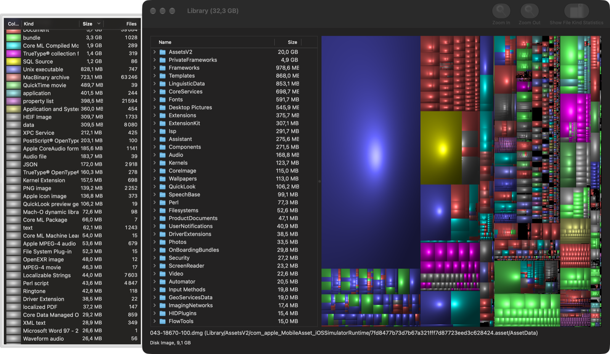

# Disk Inventory X

**Disk Inventory X** is a disk-usage visualizer for macOS. It scans a folder or volume,
builds a model of the file system, and renders it as a **treemap** — a "cushion"
visualization where each file is a rectangle sized by how much disk space it uses — so you
can see at a glance what is filling up your disk and act on it.



It is a native Cocoa (AppKit), document-based macOS application written in Objective-C, and
is free software under the **GNU General Public License v3** (see [`COPYING`](COPYING)).

## Features

- **Treemap view** — squarified cushion rendering of a whole volume or folder, full
  resolution on Retina displays, with Dark Mode support.
- **File kinds statistic** — space grouped by file type, with per-kind colors.
- **File outline & selection list** — drill into the tree and inspect individual items.
- **Act on results** — reveal an item in Finder or move it to the Trash.
- **Incremental refresh** — re-scan just the selection instead of the whole volume.
- **Localized** in English, German, Spanish, and French.

## Platform support

| | |
|--|--|
| Chip | **Apple Silicon (arm64) only** |
| macOS | 12.0 (Monterey) or later |
| Intel | ❌ Not supported — Intel/x86_64 is intentionally dropped (Rosetta is being deprecated; Intel Macs are past end-of-life). |

Native arm64 support shipped in **[v1.4b3](https://github.com/gberhault/Disk-Inventory/releases/tag/v1.4b3)**
([Epic #2](https://github.com/gberhault/Disk-Inventory/issues/2)): the app builds as a
self-contained arm64 binary that links only system frameworks.

## Download

Get the latest DMG from the [Releases page](https://github.com/gberhault/Disk-Inventory/releases).
Builds are **ad-hoc signed but not notarized**, so Gatekeeper warns on first launch:
right-click the app → **Open** (or **System Settings → Privacy & Security → Open Anyway**).

## Building

Open `Disk Inventory X.xcodeproj` in Xcode and build the **Disk Inventory X** scheme, or:

```bash
xcodebuild -project "Disk Inventory X.xcodeproj" -scheme "Disk Inventory X" -configuration Debug build
```

Run the unit tests (they live in their own scheme):

```bash
xcodebuild -project "Disk Inventory X.xcodeproj" -scheme "Disk Inventory X Tests" -configuration Debug test
```

To build without a signing identity, add `CODE_SIGNING_ALLOWED=NO`. `BuildRelease.sh` runs
a plain Release build. The project uses **Hardened Runtime**; published builds are ad-hoc
signed (see [Download](#download)).

### Dependencies

The project builds self-contained with no external frameworks:

- `TreeMapView` — the treemap renderer, **vendored** in
  [`treemapview-framework/`](treemapview-framework/) and compiled into the app
  ([#7](https://github.com/gberhault/Disk-Inventory/issues/7)).
- The legacy [Omni Group](https://github.com/omnigroup/OmniGroup) frameworks
  (`OmniAppKit`, `OmniFoundation`, `OmniBase` — an unmaintained 2018 Intel-only set) have
  been **removed**; the toolbar and preferences window are reimplemented on plain AppKit
  ([#4](https://github.com/gberhault/Disk-Inventory/issues/4),
  [#5](https://github.com/gberhault/Disk-Inventory/issues/5)).

Remaining deprecated-API cleanup is tracked in
[Epic #10](https://github.com/gberhault/Disk-Inventory/issues/10).

## Project layout

Sources sit mostly at the repository root:

- **Model / scanning** — `FSItem`, `FSItem-Utilities`, `FSItemIndex`, `NSURL-Extensions`,
  `FileSystemDoc` (the `NSDocument`)
- **Views / controllers** — `MainWindowController`, `TreeMapViewController`,
  `FilesOutlineViewController`, `FileKindsTableController`, `SelectionListController`, panels
- **Preferences** — `Preferences`, `PrefsPanelController`, `*PrefPage`
- **Formatters / transformers** — `FileSizeFormatter`, `*Transformer`
- `Foundation Extensions/` — category helpers · `*.lproj/` — localized resources ·
  `documentation/` — project notes · `CocoaTech-Depreciated/` — legacy, not built

See [`CLAUDE.md`](CLAUDE.md) for the full annotated structure and common-task map.

## Contributing / development workflow

This repository follows a spec-driven, test-first workflow documented in
[`CLAUDE.md`](CLAUDE.md):

- Work is tracked as **GitHub Issues** (epics → issues); create the issue before branching.
- Never commit directly to `master`; use `feature/…` / `bugfix/…` / `chore/…` branches and
  open a PR into `master`.
- Every change ships with tests; the project targets **80%+ coverage** (XCTest + `xccov`).
- Version bump (`MARKETING_VERSION`) lands on the branch before the PR; tag `vX.Y.Z` after merge.
- User-facing text must be localized into all supported languages.

## Support the project

Disk Inventory X is free software, developed in spare time. If it helps you reclaim disk
space and you'd like to support continued development, you can sponsor the project:

[💜 **Sponsor on GitHub**](https://github.com/sponsors/gberhault)

Sponsorships are entirely optional — the app is and will remain free under the GPL.

## License

Disk Inventory X is licensed under the **GNU General Public License, version 3** — see
[`COPYING`](COPYING). Originally created by **Tjark Derlien**.
